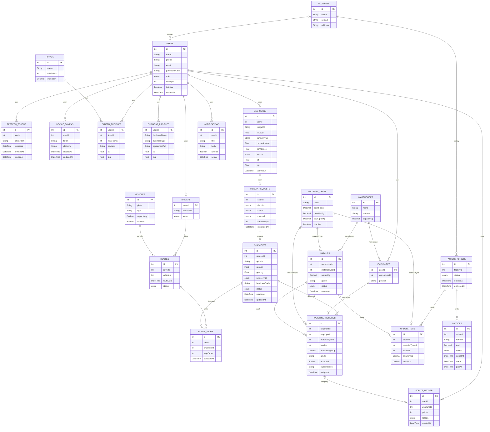

# Entity relationship diagram

Generated from `apps/backend/prisma/schema.prisma` (24 tables) by `scripts/gen-docs.py`. Chain of custody: Shipment -> WeighingRecord -> Batch -> OrderItem -> FactoryOrder. `points_ledger` is append-only.

